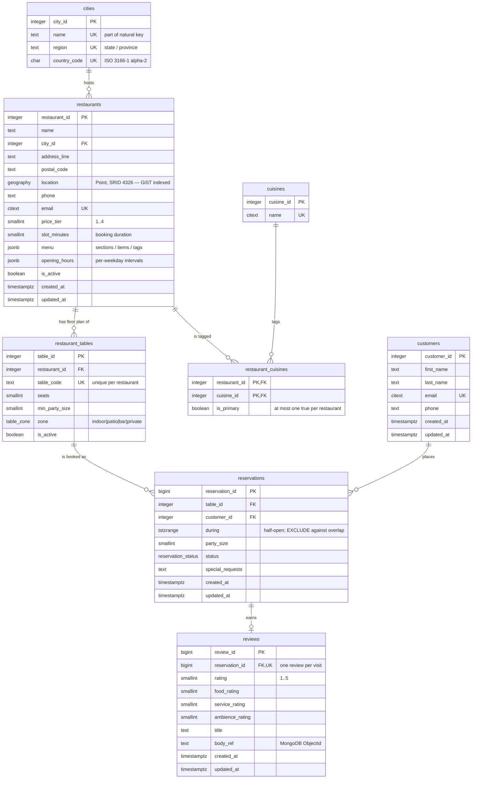

# Schema Design — Restaurant Reservation & Review System

Day 1 deliverable: the 3NF relational design, the ER diagram, and the reasoning
behind each modelling decision.

---

## 1. ER diagram



### Cardinalities in words

| Relationship | Cardinality | Notes |
|---|---|---|
| city → restaurants | 1:N | `ON DELETE RESTRICT` — a city with restaurants cannot be removed |
| restaurant → tables | 1:N | `ON DELETE CASCADE` — the floor plan has no life of its own |
| restaurant ↔ cuisines | M:N | resolved by `restaurant_cuisines` |
| table → reservations | 1:N | `ON DELETE RESTRICT` — booking history outlives furniture rearrangement |
| customer → reservations | 1:N | `ON DELETE RESTRICT` — preserves history; deactivate instead of delete |
| reservation → review | 1:0..1 | `UNIQUE(reservation_id)` makes it at most one |

---

## 2. Normalization argument

### 1NF — atomic attributes, no repeating groups

Every relational column holds a single value. The one place a repeating group
was tempting is cuisine tagging: `cuisine_1` / `cuisine_2` columns, or a
comma-joined `'Italian,Vegetarian'` string, both break 1NF and make "find every
Italian restaurant" a text-scanning problem. `restaurant_cuisines` resolves it
properly.

`menu` and `opening_hours` are the deliberate exceptions — see §3.

### 2NF — no partial key dependencies

Only one table has a composite primary key: `restaurant_cuisines
(restaurant_id, cuisine_id)`. Its single non-key attribute, `is_primary`,
describes the *pairing* — it depends on both halves of the key, not one. Every
other table is keyed on a single surrogate column, so 2NF is satisfied trivially.

### 3NF — no transitive dependencies

Four places where the obvious design would have introduced one:

| Would-be violation | Resolution |
|---|---|
| `region`, `country_code` stored per restaurant → they depend on the *city name*, not the restaurant | extracted into `cities`; restaurants hold `city_id` |
| `restaurant_id` on `reservations` → functionally determined by `table_id` (table → restaurant) | omitted; joins traverse `restaurant_tables` |
| `customer_id` / `restaurant_id` on `reviews` → both determined by `reservation_id` | omitted; a review is reached through its visit |
| `avg_rating` / `review_count` on `restaurants` → derived from `reviews` | computed in `v_restaurant_ratings` |

The two omitted foreign keys are the load-bearing decisions, and both buy
correctness rather than just tidiness. Storing `restaurant_id` on `reservations`
would permit a row claiming restaurant A while pointing at a table in restaurant
B; storing `restaurant_id` on `reviews` would permit a review whose restaurant
contradicts the visit it describes. Removing the column removes the class of bug,
and no constraint short of a trigger could have caught it otherwise.

**BCNF also holds:** every determinant in the schema is a candidate key.
`cities` is the only table with a non-trivial natural key
(`name, region, country_code`), and that key is itself a candidate key, so the
usual BCNF-but-not-3NF trap does not arise.

### The cost, and how it is paid

Strict 3NF pushes reporting queries through a four-table chain: `reviews →
reservations → restaurant_tables → restaurants → cities`. That cost is paid once
in `sql/05_views.sql` (`v_reservation_details`, `v_restaurant_reviews`,
`v_restaurant_ratings`) rather than being copied into every analytical query.
If Day 4's `EXPLAIN ANALYZE` shows the rollup dominating, the escalation path is
a materialized view refreshed on review write — not denormalizing the base tables.

---

## 3. Deliberate exemptions from normalization

**`menu` and `opening_hours` (JSONB).** Both are read as whole documents, vary in
shape between restaurants, and are never the subject of a join. Decomposing the
menu into `menu_sections` + `menu_items` + `item_tags` would add three tables and
a multi-way join to answer a question the application always asks as "give me
this restaurant's menu". They are validated structurally rather than left
free-form:

- `jsonb_typeof(menu) = 'object' AND jsonb_typeof(menu->'sections') = 'array'`
- `jsonb_typeof(opening_hours) = 'object'`

and indexed for the queries that do reach inside them (GIN `jsonb_path_ops` for
menu containment, plain GIN for weekday key probes).

**Enums (`table_zone`, `reservation_status`).** Small, stable, application-owned
vocabularies with no attributes of their own. A lookup table would be the right
call the moment a zone needs a description or a display order.

**`location` as a single `geography` point.** Latitude and longitude are
deliberately *not* stored as separate columns; they are derivable via
`ST_Y`/`ST_X`, and duplicating them would create a second source of truth that no
constraint could keep aligned with the geometry.

---

## 4. The booking invariant

The core requirement is that a table cannot be double-booked. Rather than leave
this to the application, the interval is modelled as one `tstzrange` column and
the rule is declared:

```sql
CONSTRAINT reservations_no_double_booking
    EXCLUDE USING gist (table_id WITH =, during WITH &&)
    WHERE (status IN ('pending', 'confirmed', 'seated', 'completed'))
```

Three consequences worth being explicit about:

1. **Concurrency safety is free.** A check-then-insert in application code has a
   race window between the two statements; two concurrent bookings can both read
   "available" and both insert. The exclusion constraint closes that window at the
   storage layer, so Day 2's transaction is correct even under simultaneous
   commits — it gets `SQLSTATE 23P01` and retries or reports, instead of silently
   corrupting the schedule.
2. **Half-open bounds are mandatory,** enforced by
   `reservations_during_half_open`. With closed `[]` bounds a 19:30 booking would
   "overlap" an 18:00–19:30 one at the shared instant and be wrongly refused.
   Checks 3 and 4 in `sql/99_checks.sql` pin both directions of this behaviour.
3. **Which statuses hold a table is a business decision, written down.**
   `pending`, `confirmed`, `seated` and `completed` block; `cancelled` and
   `no_show` release the slot for rebooking. Making the constraint partial is what
   lets a cancellation free capacity without deleting history.

Two rules span tables and therefore cannot be `CHECK` constraints — they live in
`sql/03_triggers.sql`:

- a party must fit between the table's `min_party_size` and `seats`
- a review requires a `completed` reservation whose end time has passed

---

## 5. Index rationale

| Index | Serves |
|---|---|
| `reservations_no_double_booking` (GiST, implicit) | the overlap constraint **and** the availability anti-join — verified as an index-only scan, 0 heap fetches |
| `idx_tables_restaurant_capacity` | "active tables at restaurant X seating N", partial on `is_active` |
| `idx_reservations_starts_at` | time-slot reads that have no `table_id` (nightly covers, Redis cache warming) |
| `idx_reservations_customer_recent` | "my bookings, newest first"; also the missing FK index on `customer_id` |
| `idx_restaurants_location` (GiST) | `ST_DWithin` radius search and `<->` nearest-neighbour ordering |
| `idx_restaurants_city` | per-city listing and the `RANK()` partition key |
| `idx_restaurants_menu` (GIN, `jsonb_path_ops`) | menu containment, e.g. items tagged `vegan` |
| `idx_restaurants_opening_hours` (GIN) | weekday key probes |
| `idx_restaurants_name_trgm` (GIN) | `ILIKE '%…%'` name search, which no btree can serve |
| `idx_reviews_reservation_rating` | index-only aggregation for the ratings rollup |

At current seed volume the planner correctly ignores some of these — 96
`restaurant_tables` rows fit in three pages, so a sequential scan beats an index
lookup. That is the right choice, not a defect. Measured outcomes for every
index here are in [`docs/performance.md`](performance.md): the exclusion
constraint's GiST index earns its keep on 9.5k reservations (index-only scan,
0 heap fetches, 16-18x faster than a forced sequential scan), while
`idx_restaurants_location` needs ~50k rows before the planner will touch it.

---

## 6. Known gaps

Scoped out of Day 1, listed so they are not mistaken for oversights:

- **Restaurant-local time zones.** `opening_hours` stores wall-clock strings
  (`"17:00"`) while `reservations.during` is an absolute `timestamptz`.
  Interpreting one against the other across cities needs an IANA time-zone column
  on `restaurants`. The container runs UTC so the seed is self-consistent, but a
  real deployment must close this.
- **Opening hours are not enforced against bookings.** Nothing currently rejects a
  reservation at 03:00 on a day the restaurant is closed. This is validation work
  for the Day 2 booking function (or a trigger reading `opening_hours`).
- **No table combining.** Real systems seat a party of 6 by joining two 4-tops;
  here a booking maps to exactly one table.
- **No waitlist, deposits, or partial-party seating.**
- **`reviews.body_ref` is format-checked but not referentially enforced** — no
  database can enforce a foreign key into MongoDB. `app.feedback.reconcile()`
  stands in for that constraint by checking it on demand; see the Day 3 section
  of the README.